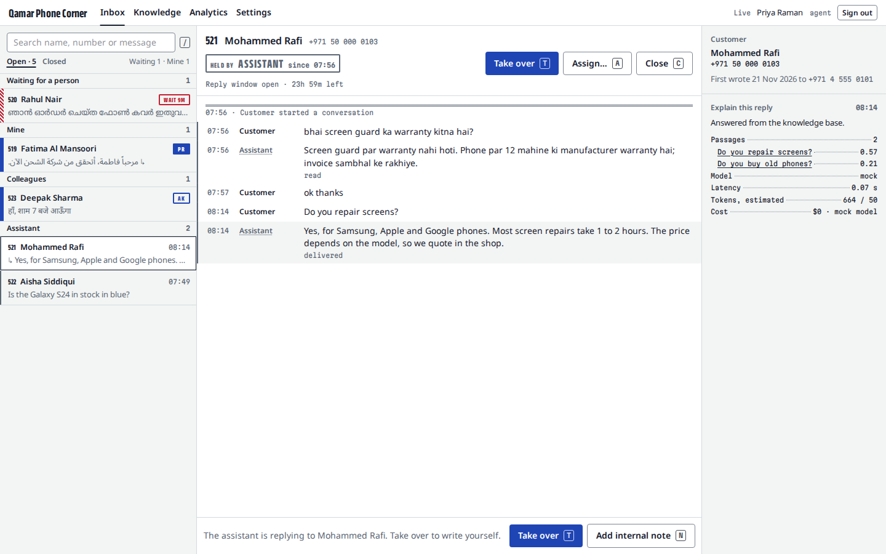
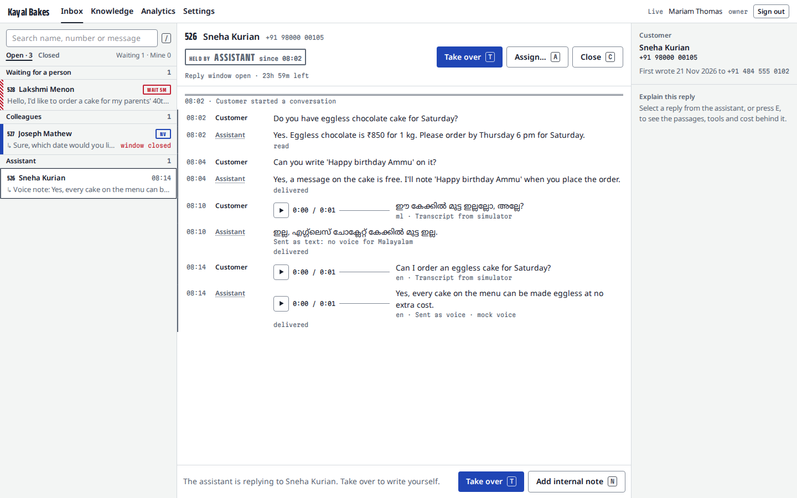
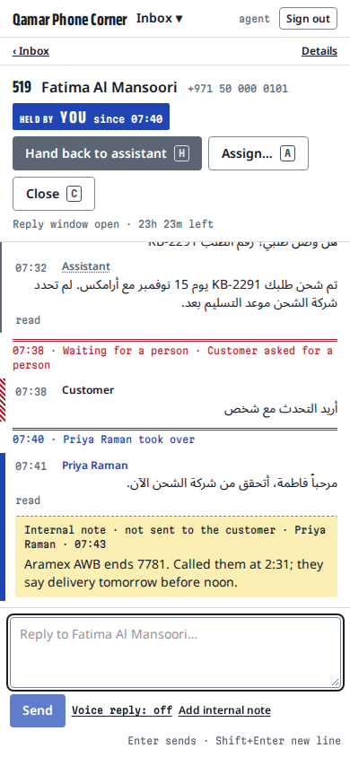
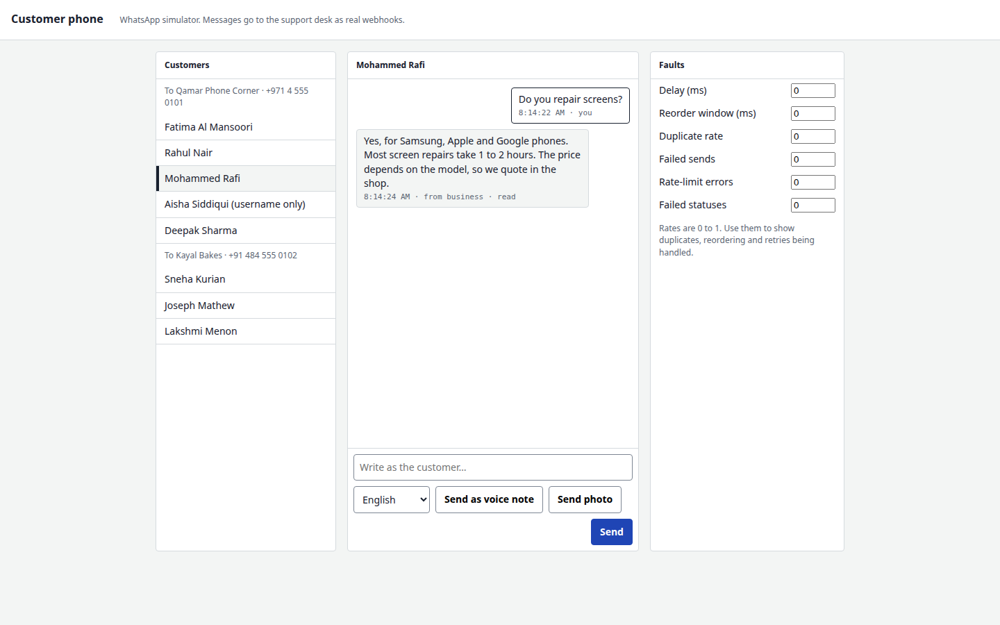
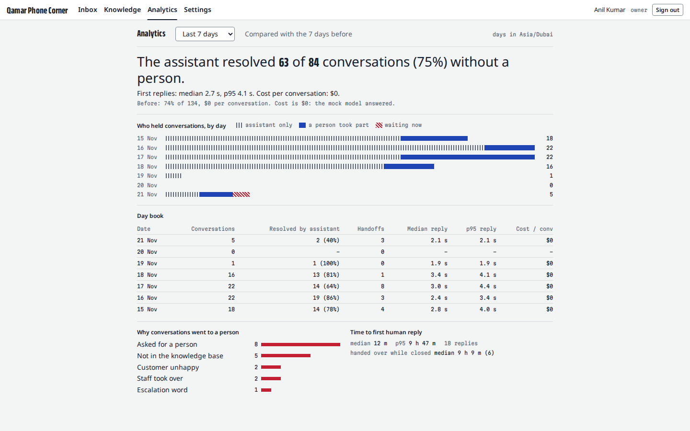
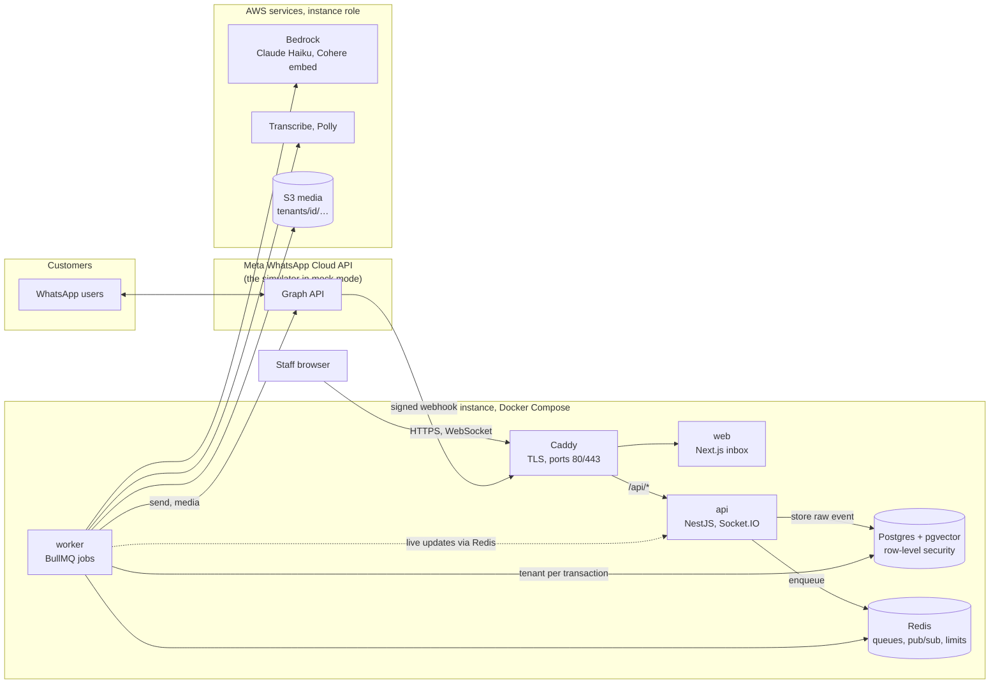
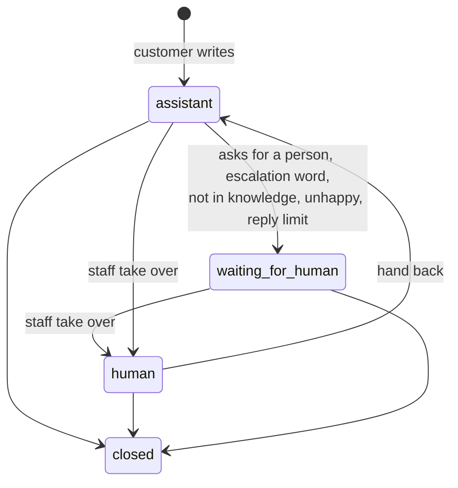

# Support desk: a WhatsApp AI assistant with a human inbox

A multi-tenant support desk for small businesses in India and the Gulf. A business connects its WhatsApp number. An assistant answers customers from that business's own knowledge: FAQs, catalogue, policies and order status. It answers in English, Hindi, Hinglish, Malayalam or Arabic, by text or by voice note. When it isn't sure, or the customer asks for a person, the conversation moves to a live inbox where staff take over and later hand it back.



**Status:**

- **Built and tested:** everything runs offline in mock mode. The full test suite passes locally and runs in the GitHub Actions workflow on every push.
- **Written, not yet run against real services:**
  - the live adapters: Claude and Cohere on Amazon Bedrock, Transcribe, Polly, S3 and Meta's WhatsApp Cloud API;
  - the AWS deployment: Terraform, deploy and backup scripts, and the runbook.
- **Not yet done:**
  - no live demo URL;
  - no answer-quality numbers from the real model (see [Measured results](#measured-results)).

## What it does

- **WhatsApp pipeline:**
  - Signed webhooks are stored raw, acknowledged at once and processed from a queue.
  - Duplicates are ignored, replies stay in order per conversation, and failed sends retry with backoff into a dead-letter table.
  - The 24-hour reply window is respected.
- **Grounded assistant:**
  - Claude Haiku answers only from retrieved passages and the `lookup_order` tool. Otherwise it says so and offers a person.
  - It declines requests unrelated to the business. WhatsApp's terms ban general-purpose assistants.
  - Customer messages and uploaded documents are treated as data, never instructions.
- **Ownership you can see:** every conversation is held by exactly one of the assistant, a waiting queue, a person, or closed. Every change is logged with who made it and why. The assistant never sends while a person holds the conversation.
- **Explain this reply:** for any assistant message, the passages it read, the tools it called, its latency, tokens and cost.
- **Voice notes both ways:**
  - Incoming notes are transcribed (language ID limited to the business's languages) and shown beside a player.
  - Replies go out as voice where Polly has a voice for the language, and as text otherwise (Malayalam).
- **Tenant isolation in the database:** every tenant table has row-level security, and the app connects as a role that can't bypass it. Tests prove one business can't read or change another's data through the API, the WebSocket or a background job.
- **Analytics and settings:**
  - Analytics: share resolved without a person, reply times, handoff reasons, cost per conversation.
  - Settings: opening hours, tone, escalation words, reply limit, languages, voice replies, staff invites.
- **A WhatsApp simulator** that speaks Meta's API and webhook format. It plays many customers and injects faults: duplicates, reordering, delays, failed sends and rate limits. Product code is identical in mock and live mode.

## Run it

Needs Node 24, pnpm and Docker. Everything runs offline in mock mode, with a scripted model and a local embedder.

```sh
make setup   # dependencies, git hooks, .env from .env.example
make dev     # Postgres and Redis in Docker, seeded demo data, all apps in watch mode
```

- **Desk:** <http://localhost:3000>. The demo accounts are listed on the sign-in page; the password is `counter-demo-2026`.
- **Simulator:** <http://localhost:4010>. Pick a customer and write as them.
- **Port 3000 taken?** Run `make dev WEB_PORT=3300 PUBLIC_APP_URL=http://localhost:3300`.

## Two-minute demo

On a fresh seed (`make reset && make dev`; `make reset` deletes your local data), open the desk and the simulator side by side. Sign in as **Priya Raman** (`priya@qamar.example`), an agent at Qamar Phone Corner, a phone shop in Karama, Dubai.

| Time | Do                                                                                                                                                                                              | What it shows                                                                                                                              |
| ---- | ----------------------------------------------------------------------------------------------------------------------------------------------------------------------------------------------- | ------------------------------------------------------------------------------------------------------------------------------------------ |
| 0:00 | In the simulator, as **Mohammed Rafi**, send `Do you repair screens?`                                                                                                                           | The reply appears on the phone and in the inbox, after the 1.5 s wait for more messages.                                                   |
| 0:15 | In the desk, open Rafi's conversation and press **E**                                                                                                                                           | The receipt: the passages retrieved with their scores, the model, latency, tokens and cost. Mock mode shows the mock model at $0.          |
| 0:30 | As **Aisha Siddiqui**, send `mujhe kisi insaan se baat karni hai`                                                                                                                               | The conversation jumps to **Waiting for a person** with the reason "Customer asked for a person". The assistant stops.                     |
| 0:45 | Open it, press **T** to take over, reply in Hindi, then use **Add internal note** for a note to colleagues                                                                                      | The held-by badge changes to you; the transfer is logged in the thread. The note is never sent.                                            |
| 1:00 | Click **Hand back to assistant** (or press **H** outside the reply box)                                                                                                                         | The assistant answers the next message again.                                                                                              |
| 1:10 | As **Mohammed Rafi**, send `I want a refund`                                                                                                                                                    | An escalation word set in Settings goes straight to a person, before the model runs.                                                       |
| 1:20 | In the simulator, set **Duplicate rate** to `0.5` and **Failed sends** to `0.3`, then send a few messages as Aisha                                                                              | Each message is stored once; each reply reaches the phone once, in order. Failed sends retry with backoff.                                 |
| 1:40 | Sign in as **Mariam Thomas** (`mariam@kayal.example`), owner of Kayal Bakes in Kochi. As **Sneha Kurian**, choose Malayalam, type `ഈ കേക്കിൽ മുട്ട ഇല്ലല്ലോ, അല്ലേ?` and press **Send as voice note** | A transcript beside the player. The reply goes out as text, since Polly has no Malayalam voice; an English voice note gets a spoken reply. |
| 1:55 | Open **Analytics**, then **Settings**                                                                                                                                                           | The seeded month of history (generated demo data, not measurements), and the rules the assistant follows.                                  |

<table><tr>
<td width="62%"></td>
<td width="38%"></td>
</tr></table>

<table><tr>
<td width="50%"></td>
<td width="50%"></td>
</tr><tr>
<td>The simulator plays the customers and injects faults.</td>
<td>Analytics over the seed's generated history: demo data, not measurements.</td>
</tr></table>

Screenshots come from `scripts/readme-screenshots.sh`: a freshly seeded database, mock mode, customers writing through the simulator. The same script checks that the demo above still works.

## Architecture



**A message's path:**

1. The webhook's HMAC is checked against the raw body. The raw event is stored and acknowledged with a 200, and a job is queued.
2. The worker parses it and deduplicates on WhatsApp's message ID (a unique constraint). Voice notes go to S3 and then Transcribe.
3. After a 1.5 s wait for more messages, it runs the assistant: rules first (opening hours, escalation words, reply limit), then retrieval and Claude with tools, then guards on the output.
4. The reply goes into a per-conversation outbox, so replies stay in order without BullMQ Pro (D-038).
5. Status webhooks (sent, delivered, read, failed) update each message, and the inbox hears about everything over the socket.



A message after a conversation is closed starts a new conversation, held by the assistant.

## Measured results

These numbers come only from the scripts that produce them, with the date of the run. Re-run the script to update them.

**Load test** ([docs/LOAD-TEST.md](docs/LOAD-TEST.md), `make load-test`, 2026-11-21, mock mode on a laptop):

- **The run:** 1,000 customer messages from 200 customers.
- **Faults switched on:** 20% duplicate webhook deliveries, reordering within 300 ms, 100 ms delay, 5% failed sends and 5% rate-limit errors.

| Check                                                       | Result                                                         |
| ----------------------------------------------------------- | -------------------------------------------------------------- |
| Messages stored                                             | 1000 of 1000, 0 stored twice                                   |
| Replies                                                     | 678 sent, 678 on the phones, 0 twice, 0 out of order, 0 failed |
| Customers left without an answer                            | 0                                                              |
| Webhook deliveries handled                                  | 1667, for 1000 messages and their statuses                     |
| Replies that needed a retry / went to the dead-letter queue | 54 / 0                                                         |
| Reply time, customer message to reply sent: median / p95    | 3.27 s / 4.41 s                                                |

Reply time includes the deliberate 1.5 s wait, the hold behind the previous reply's delivery, and retries after injected failures. With the mock model the assistant's own work is 0.02 s; a real model adds its own time.

The first run of this test found a real bug: a message arriving while a reply was being written was never answered. The cause and the fix are in D-097.

**Answer quality:**

- **Not measured yet.** `make eval` runs 54 scripted conversations across both businesses and all five languages through the production code. Each is scored on four checks: grounded, correct handoff, declines off-topic, language matched. A stronger Claude grades groundedness and language, and the results come from Haiku 5.5 and Haiku 4.5 side by side.
- **It needs AWS credentials and costs money,** so it hasn't run. [docs/EVALS.md](docs/EVALS.md) holds an offline run with the scripted mock model. It checks the eval machinery, not answer quality, and says so at the top.
- **Real reply times and cost per conversation** will come from that run and from the stored traces on the analytics page.

**Production stack, offline:** `make rehearsal` runs the production images and Compose file behind Caddy. It checks:

- TLS with HSTS;
- a Secure session cookie;
- the WebSocket upgrade;
- only Caddy exposed;
- backup, restore drill and a full restore;
- that a spoofed client address can't escape the sign-in limit.

## Trade-offs

Each of these is a decision with the alternative rejected, in [docs/DECISIONS.md](docs/DECISIONS.md).

- **One EC2 instance runs everything** (web, api, worker, Postgres, Redis, Caddy).
  - **What it buys:** a small fixed cost, one place to look when something breaks, and a restore that is one command.
  - **What it costs:** seconds of downtime per deploy, no redundancy across Availability Zones, and up to a day of data lost on a full restore (nightly backups).
  - **The upgrade path:** Postgres on RDS with point-in-time recovery, then a second app instance behind a load balancer, then ECS. The images, migrations and SSM settings carry over unchanged. The runbook lists the steps.
- **Row-level security instead of a database per tenant.** One schema and one connection pool, with isolation enforced by Postgres rather than by remembering a `where` clause. Tenant data is reached only through `withTenant()`, which sets the tenant per transaction (D-019, D-020).
- **A Postgres outbox for reply order, not BullMQ Pro's groups.** Per-conversation FIFO without a paid licence, at the cost of a per-conversation advisory lock and a sweep (D-038).
- **A 1.5 s wait before answering.** People send three short messages instead of one long one; answering each would be noisy and cost three model calls. Every reply is slower by that much (D-064).
- **Rules before the model.** Opening hours, escalation words and the reply limit are checked in code, so they hold even if the model misbehaves (D-083).
- **Haiku, not a bigger model.** Short, grounded support answers don't need more. Haiku 4.5 works by changing one setting, and the evals compare both. That comparison is still pending.
- **Batch Transcribe, not streaming.** A voice note arrives complete, so batch is simpler. The cost is the batch job's turnaround before the assistant can answer. Live calls would need streaming (proposal P-13).
- **No vision, no OCR in v1.** The assistant acknowledges images and documents and offers a person (P-06, P-07).
- **Mock and live behind the same interfaces.** Every external system has a mock (simulator, scripted model, hashed n-gram embedder, local disk), so the whole product runs and is tested offline. The cost: the mock model's answers say nothing about real quality, which is why the live eval matters.
- **Manual WhatsApp credentials,** not Meta's Embedded Signup. The owner pastes a phone number ID and a token, stored encrypted with AES-256-GCM (D-094).

## Security

- **Sign-in:** email and password through Better Auth, with scrypt hashing, httpOnly SameSite=Lax cookies (Secure in production), an Origin check on every write, and sign-in limited to 5 attempts a minute per client address.
- **Isolation:** row-level security on every tenant table. The app's database role cannot bypass it, and platform-admin views go through narrow `SECURITY DEFINER` functions.
- **Webhooks:** `X-Hub-Signature-256` is verified over the raw bytes; separate secrets per source.
- **Logs and audit:** an audit log for ownership and settings changes. Phone numbers and message text are masked in logs. Structured JSON logs carry request and conversation IDs.
- **Prompt injection:** tests cover injection both in customer messages and in uploaded documents.
- **Production:**
  - only ports 80 and 443 open, with Session Manager instead of SSH;
  - IMDSv2 required, and an instance role with least privilege;
  - secrets only in SSM Parameter Store;
  - CI reaches AWS through OIDC, with no stored keys;
  - immutable, scanned images;
  - deploys behind an approval.

## Repository

| Path                                                     | What                                                                                                                  |
| -------------------------------------------------------- | --------------------------------------------------------------------------------------------------------------------- |
| `apps/web`                                               | Next.js inbox, knowledge base, analytics, settings                                                                    |
| `apps/api`                                               | NestJS API, auth, webhooks, Socket.IO gateway, seed                                                                   |
| `apps/worker`                                            | BullMQ workers: inbound, assistant, outbound, voice, sweeps                                                           |
| `apps/simulator`                                         | Meta Cloud API stand-in with a phone page and fault injection                                                         |
| `packages/db`                                            | Drizzle schema, SQL migrations, roles, `withTenant()`                                                                 |
| `packages/pipeline`                                      | The message pipeline, shared by API and worker                                                                        |
| `packages/assistant`                                     | Prompt, retrieval, tools, guards, mock model and embedder                                                             |
| `packages/live`                                          | Bedrock, S3, Transcribe and Polly adapters                                                                            |
| `packages/voice`, `packages/whatsapp`, `packages/shared` | Ogg Opus and speech ports, Graph API client, shared zod schemas                                                       |
| `evals/`, `load/`                                        | The eval suite and the load test                                                                                      |
| `infra/terraform`, `deploy/`                             | AWS infrastructure and the scripts that run on the instance                                                           |
| `docs/`                                                  | [Brief](docs/BRIEF.md), [decisions](docs/DECISIONS.md), [design](docs/DESIGN.md), [runbook](docs/RUNBOOK.md), results |

## Commands

| Command                        | What it does                                                                                                                                                           |
| ------------------------------ | ---------------------------------------------------------------------------------------------------------------------------------------------------------------------- |
| `make check`                   | Format, lint, typecheck, unit tests, commit-message tests                                                                                                              |
| `make test-int`                | Integration tests against real Postgres and Redis: isolation, idempotency, ordering, retries, the 24-hour window, a soak with faults, no outbound network in mock mode |
| `make e2e`                     | Playwright at 1440 and 390 px, driving the inbox and the simulator together                                                                                            |
| `make load-test`               | The load test above (start `make dev` first)                                                                                                                           |
| `make eval-mock` / `make eval` | The evals offline / on live Bedrock (costs money)                                                                                                                      |
| `make infra-check`             | Terraform validate and tests with a mocked AWS provider, shellcheck, actionlint                                                                                        |
| `make rehearsal`               | The production stack locally behind Caddy, with backups and restores                                                                                                   |
| `make up`                      | Everything from the production images, mock mode                                                                                                                       |

CI runs lint, typecheck, unit, integration, end-to-end and the infrastructure checks on every push, and builds the arm64 images. It checks every commit for Conventional Commits and the authorship rule.

## Deployment

[docs/RUNBOOK.md](docs/RUNBOOK.md) is the operating manual. It covers:

- first-time setup (Terraform, DNS, secrets, GitHub, Meta);
- deploys and rollbacks;
- the assistant kill switch;
- backups (nightly to S3, a weekly restore drill) and restores;
- what to do when things break.

Deploys go from `main` through an approval to SSM Run Command on the instance. They stay switched off until the repository variable `DEPLOY_ENABLED` is set.

## Not done yet

- **No live deployment or live numbers.** The Terraform and deploy scripts are tested offline only, and the live adapters have only run against fakes of their SDKs.
- **The answer-quality eval** waits for AWS credentials (see above).
- **Two unconfirmed AWS details:**
  - Batch Transcribe's support for Ogg Opus voice notes; the live contract suite checks it.
  - The exact model condition for Claude's IAM permission.
- **Dead letters** are readable by the platform admin through the API (`GET /api/admin/dead-letters`) but have no screen yet.
- **WhatsApp calling** (customers calling the business inside WhatsApp, answered by staff or the assistant) is proposed as the next phase (P-13).
